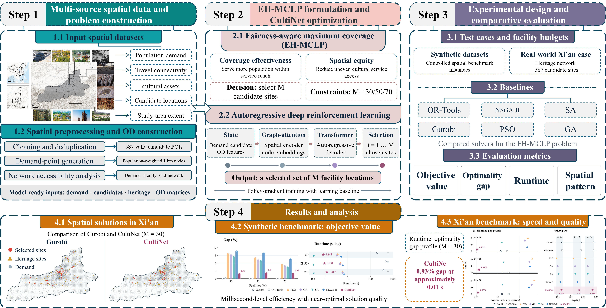
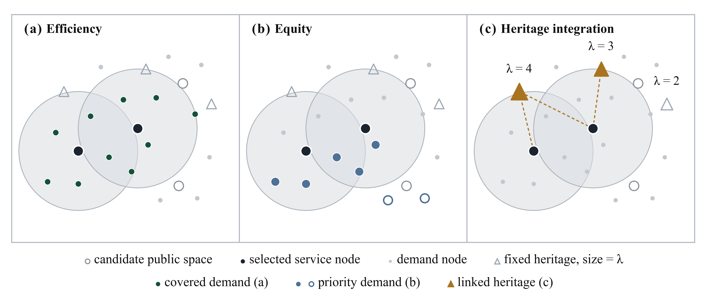
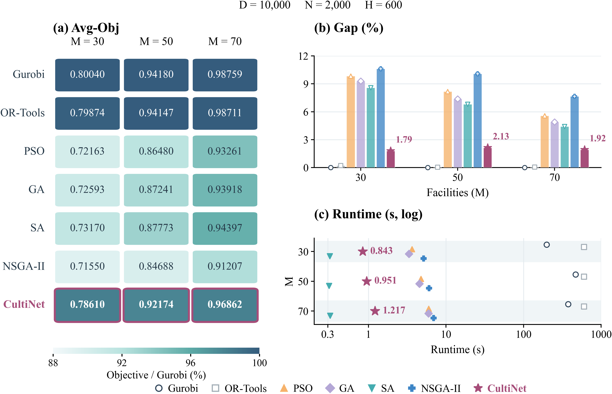
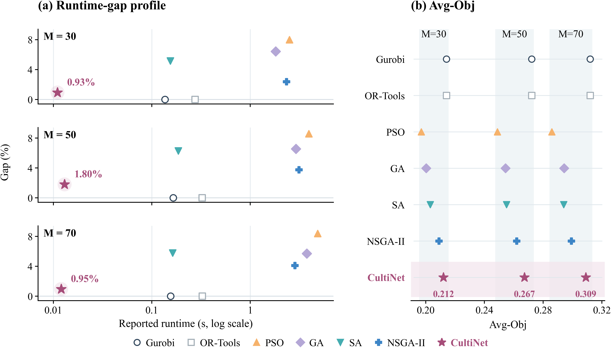

<div align="center">

# CultiNet

**Cultural facility location planning with spatial equity and heritage integration**

[Overview](#overview) · [Datasets](#datasets) · [Quick start](#quick-start) · [Experiments](#experiments) · [Repository](#repository)

</div>

## Overview

CultiNet studies where to locate cultural facilities so that they serve residents, improve access for priority communities, and connect with cultural heritage. This repository brings together the model source, spatial datasets, optimization baselines, and experiment results for a synthetic city and Xi'an.



The **equity- and heritage-aware maximal covering location problem (EH-MCLP)** selects a fixed number of eligible sites under site-capacity constraints. Its objective combines three normalized components:

- **Efficiency:** the share of the population covered by selected facilities.
- **Equity:** the share of the priority population covered.
- **Heritage integration:** the share of heritage weight linked to selected facilities.



The default objective is `F = 0.35 F1 + 0.40 F2 + 0.25 F3`. Covered population and linked heritage are counted once, even when multiple selected facilities reach them. The priority group contains approximately 30% of the population with the lowest initial heritage opportunity.

## Datasets

| Dataset | Demand points | Candidate sites | Heritage sites | Service radius |
|:--|--:|--:|--:|--:|
| Synthetic city | 10,000 | 2,000 | 600 | 1,125 m |
| Xi'an | 7,685 | 587 | 297 | 1,200 m |

The synthetic city spans 15 km × 15 km and contains a population of one million. Xi'an coordinates use the projected metric CRS **EPSG:4545**. The supplied experiments use Euclidean distances; synthetic heritage linkage also uses programme compatibility and river-crossing conditions, while Xi'an uses thematic compatibility and heritage protection weights.

See [data/README.md](data/README.md) for fields, distances, and preprocessing.

## Quick start

Use **Python 3.12**. Clone the repository and create a virtual environment:

```bash
git clone https://github.com/HIGISX/CultiNet.git
cd CultiNet
python -m venv .venv
```

Activate it:

```powershell
# Windows
.\.venv\Scripts\Activate.ps1
```

```bash
# Linux / macOS
source .venv/bin/activate
```

Install the dependencies for the six baseline methods:

```bash
python -m pip install -r requirements-solvers.txt
```

Gurobi requires a suitable license. For PSO, GA, SA, and NSGA-II, install `requirements.txt` instead. The neural-model dependencies are listed in `requirements-model.txt`.

Run the baseline comparison from the repository root:

```bash
python -u -X utf8 algo_benchmark/run_comparison.py --config algo_benchmark/compare_config_euclidean.json --output results/comparison
```

The default runs both datasets at **M = 30, 50, and 70**, with 20 runs per stochastic method and one run per exact solver. Results are written to `results/`, which is excluded from Git.

## Experiments

### Synthetic benchmark

The large synthetic instance compares objective value, optimality gap, and runtime across facility budgets. The figure includes the reported CultiNet results alongside the six baseline methods.



### Xi'an benchmark

The Xi'an comparison shows objective values and the relationship between reported runtime and gap for the three facility budgets.



CultiNet runtimes represent online inference and exclude offline training. Reported runtimes reflect their respective hardware and execution settings. Baseline tables and individual selections are available in [reference/](reference/README.md).

### Run specific comparisons

Use a fresh output directory for each run:

```bash
# One dataset
python -u -X utf8 algo_benchmark/run_comparison.py --datasets synthetic --output results/synthetic
python -u -X utf8 algo_benchmark/run_comparison.py --datasets real --output results/xian

# Run without Gurobi
python -u -X utf8 algo_benchmark/run_comparison.py --methods OR-Tools PSO GA SA NSGA-II --output results/no_gurobi

# Override selected settings
python -u -X utf8 algo_benchmark/run_comparison.py --m 30 --runs 5 --seed-start 101 --radius-m 1200 --output results/custom
```

To resume an interrupted comparison, repeat the original command with `--resume`.

### Objective-weight experiments

The Xi'an sensitivity experiment evaluates eight weight scenarios; the ablation experiment evaluates the full objective, equal weights, and the removal of each component. Both use Gurobi and require a new output directory.

```bash
python -u -X utf8 algo_benchmark/run_weight_sensitivity.py --config algo_benchmark/compare_config_euclidean.json --dataset real --m 30 --output results/weight_sensitivity
python -u -X utf8 algo_benchmark/run_weight_ablation.py --config algo_benchmark/compare_config_euclidean.json --m 30 --output results/weight_ablation
```

The default configuration, including solver limits and heuristic parameters, is in [compare_config_euclidean.json](algo_benchmark/compare_config_euclidean.json).

## Repository

```text
CultiNet/
├── algo_benchmark/       Experiment runners, configuration, and objective
├── Algorithm/            GA, PSO, SA, and NSGA-II implementations
├── assets/               Figures used in this README
├── data/                 Synthetic and Xi'an input data
├── model/                Neural-model architecture and training source
├── reference/            Experiment results and selected locations
├── requirements.txt      Dependencies for stochastic baselines
├── requirements-solvers.txt
└── requirements-model.txt
```

See [model/README.md](model/README.md) for the neural-model input format and training source.

## License

See [LICENSE](LICENSE).
